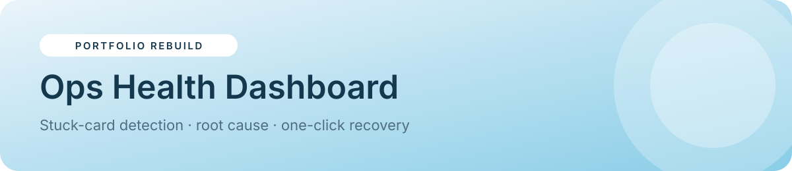

<p align="center"></p>

<p align="center">


<a href="https://sider.ai/agents/web-creator/share/695ea81100a621619985fdfb"></a>
</p>

<p align="center"><a href="https://naekitakadoportfolio.github.io/ops-health-dashboard/"></a></p>

# Ops Health Dashboard

A multi-page operations console for work items that sync between a project tool and an ad platform. It detects stuck, desynced, flapping and mismatched cards, explains the root cause, previews fixes and applies them one by one or in bulk.

> **Portfolio rebuild.** A from-scratch recreation of a production system I designed and run (Sync operations dashboard). It uses **fictional data**, with no client names, code or branding.

## ✨ Features
- **Action center:** health score, KPIs and a priority queue sorted by severity, with one-click Fix
- **All cards:** searchable, filterable table (team, issues only)
- **Card investigator:** side-by-side state, root cause, a before/after fix preview, notes and history
- **Recovery tools:** select cards for a bulk fix or Full Auto-Fix, with confirmation
- **Incidents:** timeline with cause and fix; log new incidents and resolve them
- **Health trends:** SVG trend chart plus issues by team
- **Diagnostics & settings:** stuck and flapping thresholds, an Autopilot auto-heal toggle, and the activity log
- Light/dark theme, responsive layout, state saved in your browser, and one-click **Reset demo data**

## 🧭 Try it
1. *Action center* → **Investigate** a stuck card → review the fix preview → **Apply fix**
2. Click **Simulate new incident** a few times
3. *Recovery tools* → **Full auto-fix all**
4. *Health trends* shows the score recovering
5. Turn on **Autopilot** in settings and simulate again

Open the **[live demo](https://naekitakadoportfolio.github.io/ops-health-dashboard/)**.

## 🏗 Production architecture
| Layer | Production | This demo |
|---|---|---|
| UI | Apps Script HTML Service (glass UI, light/dark) | Static SPA |
| Detection | Time-driven watchdog trigger | `diag()` on render |
| Data | Daily sync log in Sheets | `localStorage` |
| Fixes | REST calls to both systems | `plan()` / `applyFix()` |
| Alerts | Chat webhooks | Activity log |

## 📁 Project structure
```
ops-health-dashboard/
├── index.html        # built app (open this)
├── src/
│   ├── app.js        # state, views, business logic
│   └── app.json      # app config: nav, theme, storage key
├── assets/banner.svg
├── README.md
└── LICENSE
```

## 🚀 Run locally
No install needed. Open `index.html`, or:
```bash
python3 -m http.server 8000   # http://localhost:8000
```

## 🧩 Implementation notes
- `diag()` returns typed issues (stuck, desync, flap, mismatch) with severity and the recommended fix
- `plan()` builds the after-state used for both the preview and the apply step
- `snap()` records a health-score point after every change
- Thresholds are configurable and validated

## 🗺 Roadmap
- Per-team SLA targets
- Auto-assign issues to coordinators
- Webhook auth health probe

---
<p align="center"><sub>Built by <b>Nae Kitakado</b>, AI Automation Consultant · <a href="https://www.linkedin.com/in/nae-k-203194265">LinkedIn</a> · <a href="https://sider.ai/agents/web-creator/share/695ea81100a621619985fdfb">Portfolio</a> · open to retainer &amp; part-time consulting</sub></p>
